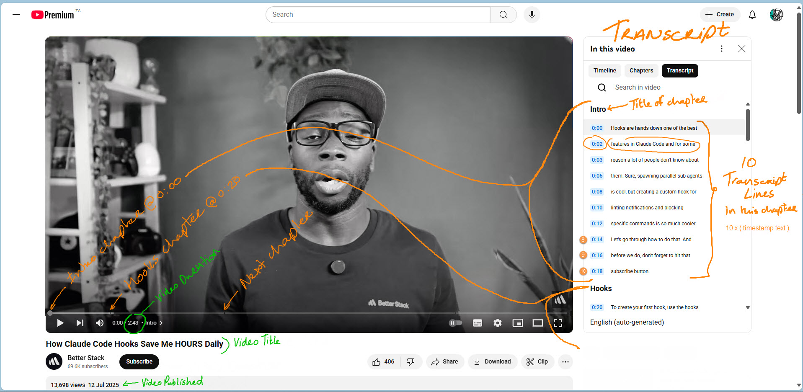
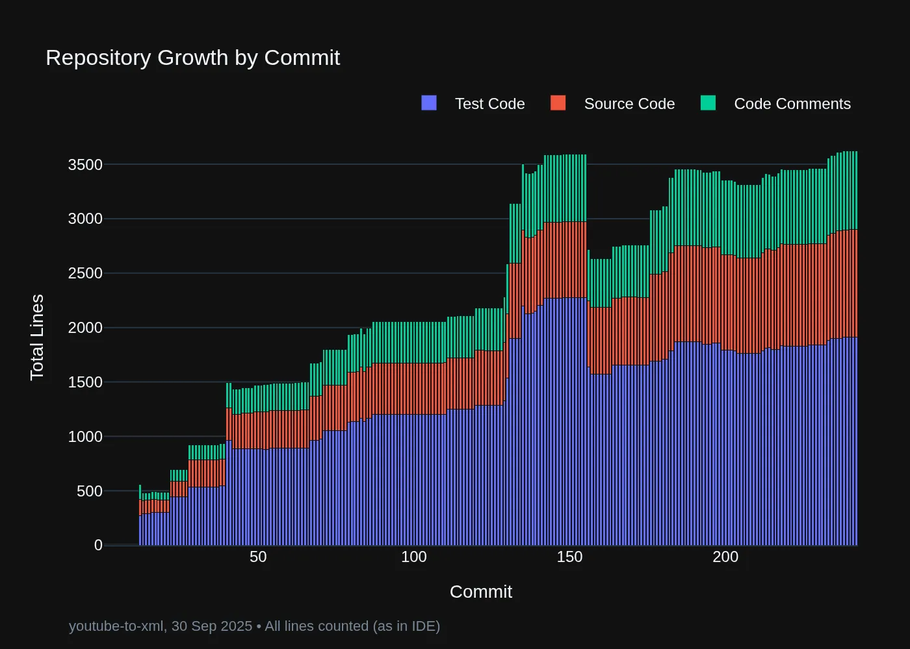

# 🎥 YouTube-to-XML

Convert YouTube transcripts to structured XML format with automatic chapter detection.

**Problem**: Raw YouTube transcripts are unstructured text that LLMs struggle to parse, degrading AI chat responses about video content.

**Solution**: Converts transcripts to XML with chapter elements for improved AI comprehension.


## 📦 Install

(1) First, install UV Python Package and Project Manager [from here](https://docs.astral.sh/uv/getting-started/installation/).

(2) Then, install `youtube-to-xml` accessible from anywhere in your terminal:

```bash
uv tool install git+https://github.com/michellepace/youtube-to-xml.git
```

Alternatively, clone the repo and prefix commands with `uv run`, e.g. `uv run youtube-to-xml --help`.

## 🚀 Usage

Pass a YouTube URL:

```bash
youtube-to-xml https://youtu.be/Q4gsvJvRjCU

🎬 Processing: https://youtu.be/Q4gsvJvRjCU
✅ Created: how-claude-code-hooks-save-me-hours-daily.xml
```

Transcript language: creator-uploaded English subtitles are preferred, then YouTube's auto-generated English captions, then YouTube's auto-translation into English.

Output XML (condensed - 4 chapters, 88 lines total):

```xml
<?xml version="1.0" encoding="utf-8"?>
<transcript video_title="How Claude Code Hooks Save Me HOURS Daily"
            video_published="2025-07-12"
            video_duration="2m 43s"
            video_url="https://www.youtube.com/watch?v=Q4gsvJvRjCU">
  <chapters>
    <chapter title="Intro" start_time="0:00">
      0:00 Hooks are hands down one of the best
      0:02 features in Claude Code and for some
      <!-- ... more transcript content ... -->
    </chapter>
    <chapter title="Hooks" start_time="0:19">
      0:20 To create your first hook, use the hooks
      <!-- ... more transcript content ... -->
    </chapter>
    <!-- ... 2 more chapters ... -->
  </chapters>
</transcript>
```

📁 **[View Output XML →](example_transcripts/how-claude-code-hooks-save-me-hours-daily.xml)**

Unlike YouTube transcripts, which put each timestamp on its own line, every line here keeps its timestamp with the text (`0:02 Welcome to this talk`). So when an agent like Claude Code searches the file, every hit shows *what* was said and *when*, with no follow-up read to find the timestamp.

*You can also pass a `.txt` file of a transcript copied from YouTube's transcript panel. See `youtube-to-xml --help` for the format.*

## 🤖 Demo: Claude Code Analysis

See **[demo-analysing-transcripts-with-claude-code.md](docs/demo-analysing-transcripts-with-claude-code.md)** for a real conversation where Claude Code analyses a 2-hour video transcript.

Interesting findings:

- **63,231 tokens** — too large for Claude Code to read at once, but it adapted by using grep and reading specific line ranges
- **XML chapters** — made it trivial to target specific sections (e.g., "analyse chapter 10 and 11")
- **Follow-up questions** — improved answer completeness. In an App this could be handled by prompt engineering.

At the time of this demo, Claude Code could only read 25,000 tokens at a time, but the Anthropic API had a 200,000 token window. So RAG isn't needed yet.

## 🏗️ Architecture

```text
                    youtube-to-xml CLI
                           │
                    ┌──────┴───────┐
                    │  cli.py      │
                    │ (auto-detect)│
                    └──────┬───────┘
                           │
              ┌────────────┴────────────┐
              │                         │
        [URL Input]              [File Input]
              │                         │
      ┌───────▼────────┐       ┌────────▼────────┐
      │ url_parser.py  │       │ file_parser.py  │
      │                │       │                 │
      │ • yt-dlp API   │       │ • Pattern match │
      │ • JSON3 parse  │       │ • Chapter rules │
      │ • Metadata     │       │ • Empty metadata│
      └───────┬────────┘       └────────┬────────┘
              │                         │
              └────────────┬────────────┘
                           │
                    ┌──────▼──────┐
                    │  models.py  │
                    │             │
                    │TranscriptDoc│
                    │  Chapters   │
                    │  Metadata   │
                    └──────┬──────┘
                           │
                    ┌──────▼──────────┐
                    │ xml_builder.py  │
                    │                 │
                    │ • Format times  │
                    │ • Build XML tree│
                    └──────┬──────────┘
                           │
                      ┌────▼────┐
                      │ XML File│
                      └─────────┘
```

- **Design**: Pure functions with clear module separation, see [CLAUDE.md](.claude/CLAUDE.md) for key modules
- **Dependencies**: Python 3.15+, `yt-dlp` for YouTube downloads, see [pyproject.toml](pyproject.toml)
- **Python Package Management**: [UV](https://docs.astral.sh/uv/concepts/projects/)
- **Terminology**: Uses TRANSCRIPT terminology throughout codebase, see [docs/terminology.md](docs/terminology.md)

<div align="left">
  <a href="docs/terminology.md">
    
  </a>
  <br>
  <em>YouTube transcript terminology used throughout the codebase (click to read)</em>
</div>

## 🛠️ Development

Run the setup below. For day-to-day dev commands, see [`.claude/CLAUDE.md`](.claude/CLAUDE.md#uv-workflow-always).

```bash
git clone https://github.com/michellepace/youtube-to-xml.git
cd youtube-to-xml
uv sync
uv run pre-commit install
uv run pre-commit install --hook-type pre-push

# xmllint pre-commit hook needs libxml2's CLI
sudo apt install libxml2-utils
```

Built test-first: 134 tests (17 slow, 117 unit), so most of the codebase is tests:

<div align="left">
  <a href="docs/images/repo_evolution_commit.webp">
    
  </a>
  <br>
  <em>Counted by my <a href="https://github.com/michellepace/plot-py-repo">plot-py-repo</a> tool</em>
</div>
